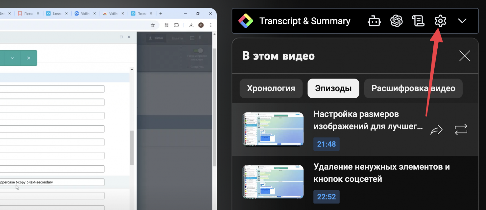
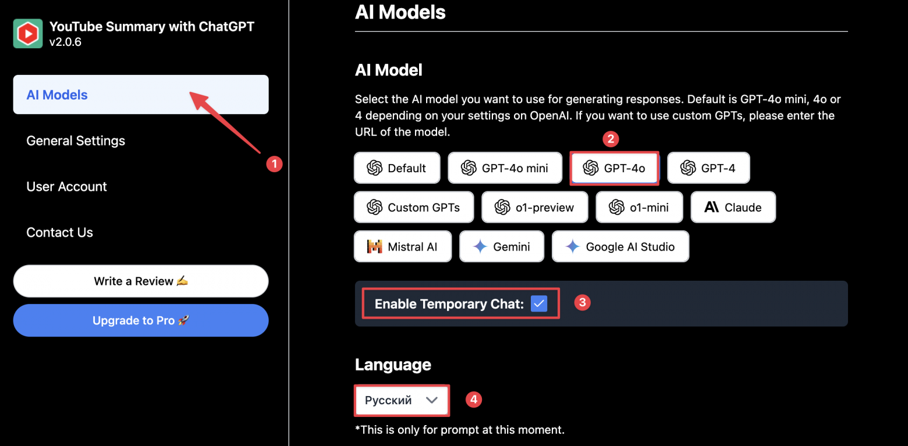
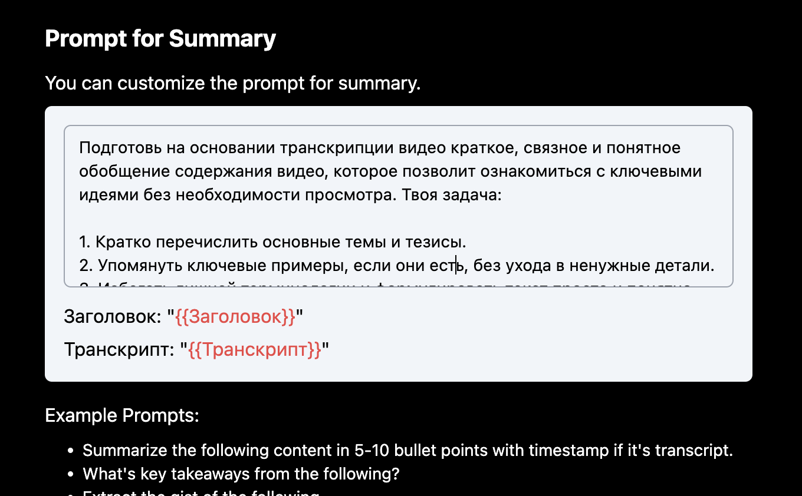
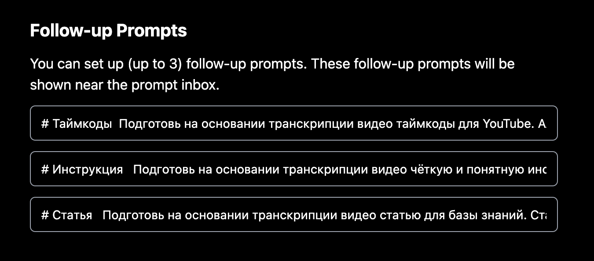
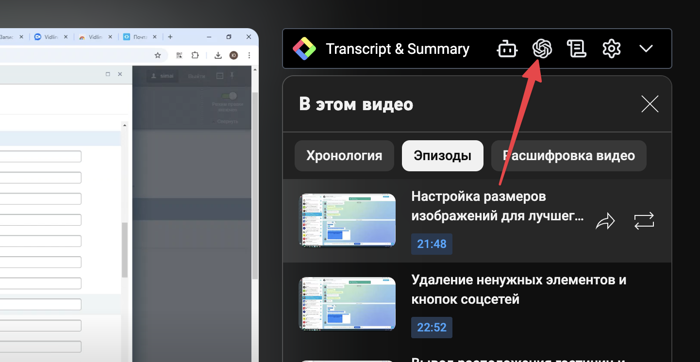
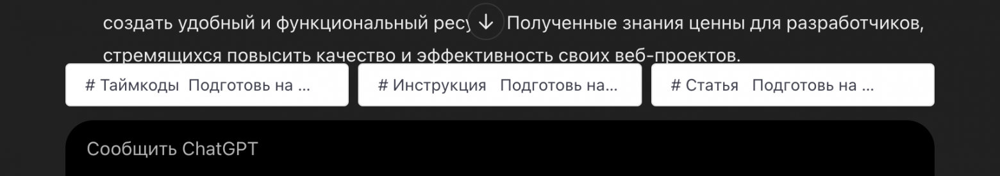
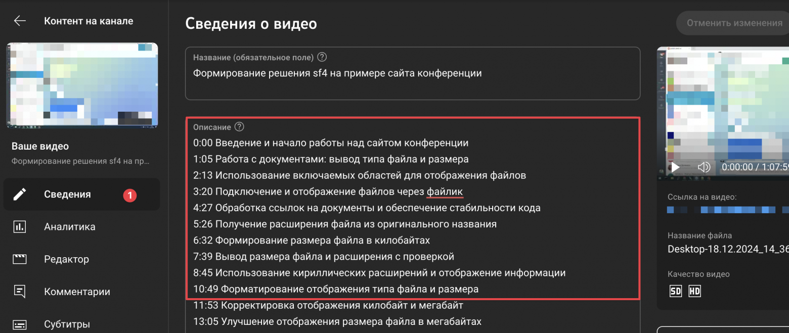

# Автоматизация обработки видео на YouTube с ChatGPT: пошаговое руководство


Если вы часто работаете с обучающими или аналитическими видео и хотите сократить время на их просмотр, расширение [**Glasp**](https://glasp.co/) для браузера может стать вашим отличным помощником. Оно позволяет автоматически выгружать субтитры, формировать краткие обзоры, таймкоды и даже готовые статьи по контенту видео. В этой статье мы рассмотрим, как установить, настроить и использовать Glasp для оптимизации вашей работы с роликами на YouTube.

### Почему стоит попробовать Glasp

**Glasp** — это инструмент, который подключается к YouTube и позволяет выполнять следующие задачи:

- Получить текстовую расшифровку (транскрипцию) видео.
- Сгенерировать краткий обзор (саммари), чтобы быстро понять основные идеи ролика.
- Автоматически подготовить таймкоды, которые можно добавить в описание на YouTube.
- Создать понятную инструкцию (пошаговое руководство) на основе видео.
- Сформировать полноценную статью для базы знаний — сразу в удобном формате.

Такой подход экономит время, упрощает переработку информации и помогает оперативно готовить полезные материалы из видео без самостоятельного конспектирования.

### Шаг 1. Установка расширения Glasp

1. Перейдите по ссылке [**Glasp**](https://glasp.co/) и скачайте расширение для вашего браузера.
2. Установите расширение, следуя стандартной процедуре. После установки рядом с YouTube-видео появится панель Glasp.

### Шаг 2. Первичные настройки расширения

Откройте любое видео на YouTube. Справа от проигрывателя вы увидите панель расширения Glasp. Нажмите на иконку шестерёнки, чтобы перейти к настройкам.

Пример настройки (из внутренней инструкции):



_Настройка расширения Glasp_

Настройте общие параметры:

- **Выбор модели**: Выберите **GPT-4o**.
- **Анонимный режим**: Установите флажок, если не хотите сохранять историю чатов.
- **Язык**: Выберите русский.



_Общие параметры настройки_

На этом этапе вы уже можете пользоваться базовыми возможностями плагина. Однако, чтобы максимально упростить работу с контентом, стоит настроить дополнительные промты.

### Шаг 3. Настройка промтов

В настройках Glasp доступны три отдельных поля для промтов. Вам нужно указать промты целиком, вместе с заголовками.

**Главный промт (Samмари)**

```
Подготовь на основании транскрипции видео краткое, связное и понятное обобщение содержания видео, которое позволит ознакомиться с ключевыми идеями без необходимости просмотра. Твоя задача:

1. Кратко перечислить основные темы и тезисы.
2. Упомянуть ключевые примеры, если они есть, без ухода в ненужные детали.
3. Избегать лишней терминологии и формулировать текст просто и понятно.
4. Завершить обобщение небольшим выводом, отражающим суть и ценность информации из видео.
```



_Пример заполнения главного промта_

Далее укажите промты для таймкодов, инструкций и статьи:

**Промт для таймкодов**

```
# Таймкоды

Подготовь на основании транскрипции видео таймкоды для YouTube. Алгоритм:

1. Объединяй схожие по смыслу фрагменты в одну строку таймкода.
2. Используй формат `м:с` или `ч:м:с` для таймкодов.
3. Кратко опиши содержание каждого таймкода, передавая основную мысль.
4. Начинай таймкоды с `0:00` и добавляй логическую последовательность на основе субтитров.
5. Ответ предоставь в текстовом формате в окне для кода, чтобы можно было скопировать.

Пример:
0:00 Введение и обзор видео
0:15 Подготовка ингредиентов
0:30 Как готовить яйца
```

**Промт для инструкций**

```
# Инструкция

Подготовь на основании транскрипции видео чёткую и понятную инструкцию (пошаговое руководство). Инструкция должна:

1. Быть изложена по шагам (например, «Шаг 1: ...», «Шаг 2: ...»).
2. Использовать простые и понятные формулировки.
3. Отражать логику и последовательность, предложенную в видео.
4. Передавать основные идеи без лишних деталей, но достаточно подробно, чтобы можно было выполнить действия, описанные в ролике.
5. Ответ предоставь в офрмате html без тегов html, body и стилей. Только само содержание.
6. Экранируй код внутри кода.
```

**Промт для статьи**

```
# Статья

Подготовь на основании транскрипции видео статью для базы знаний. Статья должна:

1. Иметь логичную структуру: краткое введение, основная часть с разделами и подзаголовками, а также чёткий вывод или заключение.
2. Преподносить материал систематизировано и понятно, даже для человека, который не смотрел исходное видео.
3. Использовать простой и чёткий язык, избегать лишних подробностей, но при этом давать достаточно информации, чтобы читатель мог понять суть без дополнительных источников.
4. Можно использовать списки, таблицы или короткие примеры, если это уместно.
5. Ответ предоставь в офрмате html без тегов html, body и стилей. Только само содержание.
6. Экранируй код внутри кода.
```



_Пример заполнения полей промтов_

После сохранения промтов вы сможете мгновенно генерировать саммари, таймкоды, инструкции и статьи на основе любого видео.

### Шаг 4. Использование Glasp в работе с видео

Теперь, когда настройки выполнены, можно перейти к анализу видео:

- **Получение транскрипции**: Расширение автоматически выгрузит расшифровку речи.
- **Генерация саммари**: Нажмите на соответствующую кнопку, чтобы получить краткое описание ролика.
- **Формирование таймкодов**: Выберите промт «Таймкоды» и получите готовую структуру для описания видео на YouTube.
- **Создание инструкций**: Промт «Инструкция» позволит сформировать пошаговое руководство.
- **Написание статьи**: Промт «Статья» создаст полноценный текст в html-формате для базы знаний.



_Выбор действий над видео_

После нажатия на кнопку, откроется окно с Chat GPT, и будет подготовлено саммари видео. Затем вы сможете выбрать дополнительные действия:



_Выбор промтов для дальнейшей работы_

### Шаг 5. Вставка таймкодов в описание YouTube-видео

Для добавления таймкодов зайдите в режим редактирования видео на YouTube и вставьте сгенерированный текст в описание:



_Редактирование описания видео_

По аналогии можно сформировать статью или инструкцию. Они будут сразу выдаваться в формате HTML, готовые к использованию.

При желании вы можете изменить промты и настроить их под себя.
