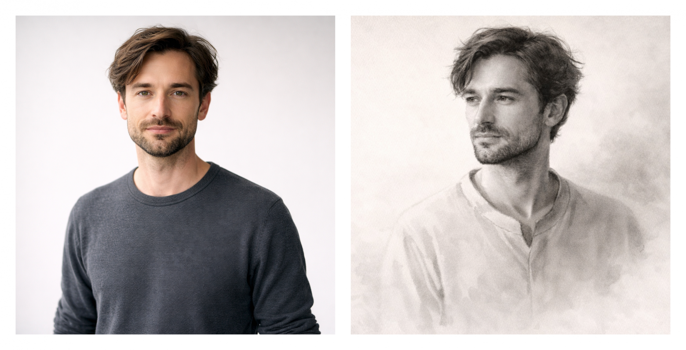

# GPT как портретист: ассистент, который рисует как художник

_Исходное фото и художественная интерпретация. Ассистент не просто меняет стиль, а переосмысливает ракурс, фон и подачу образа._

Иногда идея приходит не из плана, а из ощущения.
Я просто наткнулся на промт, который превращал фотографию в карандашный скетч — словно аккуратно нарисованный в блокноте. Без эффектов, без броской стилизации. Это выглядело не как фильтр, а как чья-то работа: с вниманием к форме, с паузами, с ощущением руки.

И в этот момент появилась мысль: если модель уже умеет так вдумчиво переносить лицо и детали, то, возможно, её можно использовать не просто как инструмент «нарисуй в стиле», а как основу для виртуального художника.

Мне хотелось сместить саму цель. Не копировать фотографию и не воспроизводить её буквально, а действовать так, как действует портретист в мастерской: посмотреть на человека, уловить характер и настроение кадра, понять, что в нём главное, что стоит подчеркнуть, а что лучше увести в тень. Сначала появляется образ — внутреннее ощущение будущей работы — и только потом становится ясно, какая подача и какая техника помогут этот образ воплотить.

Именно так я и собрал ассистента. Он начинает не с генерации, а с художественного взгляда. Он смотрит на фотографию и предлагает несколько направлений, которые подходят именно этому человеку и именно этому кадру. Не абстрактный набор стилей, а варианты того, как эта работа может зазвучать: более мягко или более строго, воздушно или драматично, спокойно или собранно.

Дальше он помогает собрать подачу. Что сделать с фоном, чтобы он не отвлекал. Какой формат будет выигрышнее. Где нужен акцент, а где — пауза. Иногда он может предложить чуть изменить композицию или аккуратно привести образ к более цельному виду — не ради эффекта, а ради выразительности. Все эти решения не навязываются: пользователь может принять их, отклонить или предложить свои.

После согласования ассистент формирует промт под выбранную концепцию и создаёт картину. Если появляются замечания или хочется «чуть иначе», работа продолжается так же, как в реальной мастерской: ассистент внимательно принимает обратную связь, помогает сформулировать её художественно и предлагает несколько вариантов, как реализовать пожелание так, чтобы результат стал сильнее — не теряя цельности и художественного характера.

Интересным для меня оказался и эффект «исследования». Иногда ассистент предлагает направления, о которых ты просто не знаешь. У меня так произошло с суйбокуга (sumi-e) — монохромной японской живописью тушью с водяной размывкой. Он сам предложил этот подход, я согласился скорее из любопытства — и результат оказался неожиданно точным и выразительным. Это был редкий случай, когда техника не украшает портрет, а действительно раскрывает его характер.

Для меня в этом ассистенте было важно сохранить баланс. С одной стороны — художественность и свобода, с другой — ощущение живого человека в портрете. Поэтому он бережно относится к лицу и ключевым чертам, а всю выразительность переносит в свет, тон и композицию — туда, где художник действительно работает с образом.

Начать с ним очень просто: достаточно загрузить фотографию. Ассистент сам посмотрит на изображение и предложит несколько художественных вариантов. Общение происходит на языке обращения пользователя; по умолчанию используется английский.

В итоге получился не генератор картинок, а виртуальный портретист — инструмент для спокойного, осмысленного творчества. Его можно использовать по-разному: для портрета, для эксперимента, для поиска нового визуального языка или просто, чтобы посмотреть на привычный образ под другим углом.

Ассистент доступен по ссылке:
[https://chatgpt.com/g/g-69439618d08881918b976d38a9cae750-portraitist](https://chatgpt.com/g/g-69439618d08881918b976d38a9cae750-portraitist)
