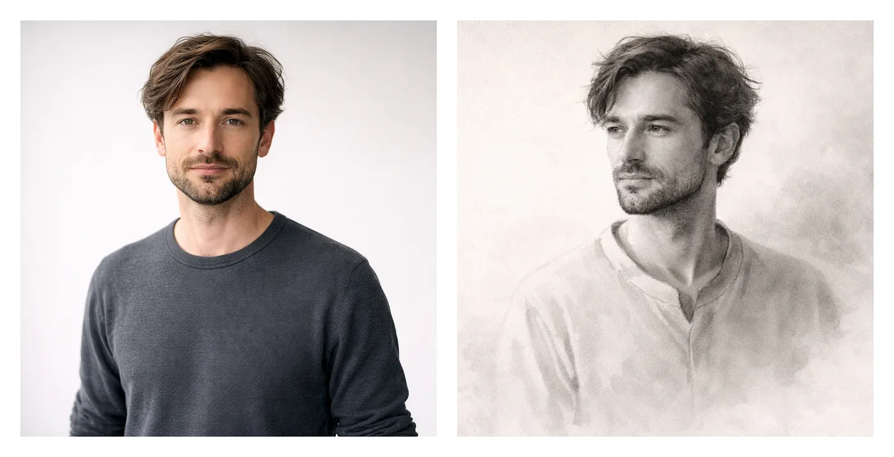

# I Built a GPT That Thinks Like a Portrait Artist

[Original publication](https://medium.com/@rim.zabarov/i-built-a-gpt-that-thinks-like-a-portrait-artist-9b909c8e1241) | [Read archived text](article.en.md)

Author: Rim Zabarov. Original language: English.

Checked against the source on 2026-10-29. The author body matches the saved edition after presentation normalization. Body images and the separately stored platform cover were inventoried; available files are local. Earlier editions remain in Git history.

## Linked Resources

- [https://chatgpt.com/g/g-69439618d08881918b976d38a9cae750-portraitist](https://chatgpt.com/g/g-69439618d08881918b976d38a9cae750-portraitist)

Linked services, videos and code repositories remain external references. No direct file attachment was found in this article's extension-based link inventory; this is not an archive of the linked websites.

Source and completeness data: [preservation](preservation.json), [completeness](completeness.json). Original media rights and attribution remain unchanged.
